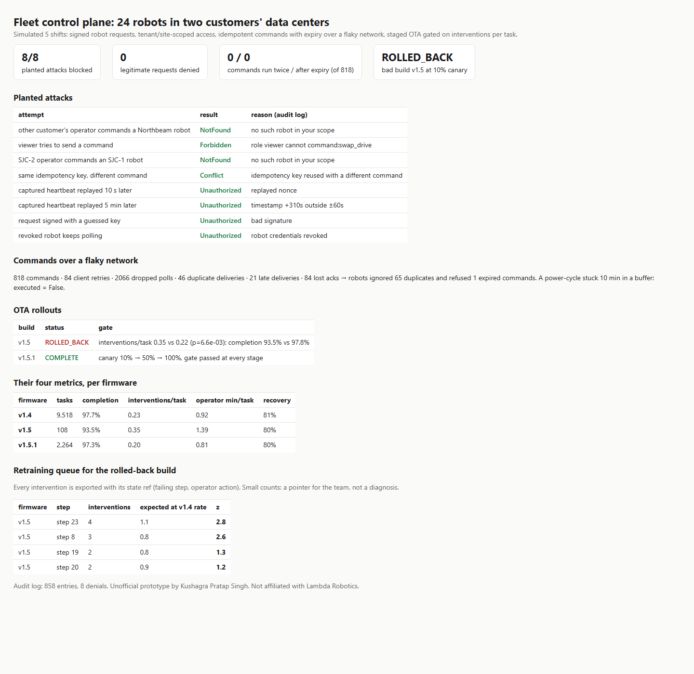

# fleetctl: a control plane for robots in other people's data centers

Lambda Robotics deploys robots into customers' AI data centers. Their open **Founding Software Engineer, Robotics Infrastructure** role asks for fleet infrastructure: "robot registration, identity, authentication, and access-control systems", secure multi-tenant architecture, monitoring, OTA updates, and command/status APIs that work over unreliable networks ([job post](https://www.ycombinator.com/companies/lambda-robotics/jobs/0oIw1pj-founding-software-engineer-robotics-infrastructure)). Their blog adds the loop: "task completion ↑ · interventions / task ↓ · operator time / task ↓ · recovery ↑", and warns about "failures logged but never retrained on" ([post](https://lambdarobotics.ai/blog/embodied-intelligence-systems-problem)).

This is a small, working version of that control plane, run against a simulated 24-robot fleet across two customers.

| Part | What it does |
|---|---|
| **Identity** | Registration issues a per-robot secret. Every robot request is HMAC-SHA256 signed over method, path, timestamp, nonce and body hash. A ±60 s window plus a nonce cache stop replays, and revocation is immediate. |
| **Tenancy** | Tenant → site → robot. viewer/operator/admin, optionally scoped to one site. Another tenant's robot returns **404**, so its existence doesn't leak. |
| **Commands** | Idempotency keys (a retried POST returns the same command; a reused key with different args → 409), a TTL, per-robot sequence numbers, and an **at-most-once, never-after-expiry** robot agent. |
| **Telemetry** | Their four metrics per firmware: completion, interventions/task, operator min/task, recovery. |
| **OTA** | Canary 10% → 50% → 100%. The gate is a two-sample binomial test on interventions (canary stage vs 24 h baseline) plus completion. A bad build is rolled back automatically. |
| **Feedback** | Every intervention is stored with its failing step, state ref and operator action, giving a retraining queue for a rolled-back build. |
| **API** | Stdlib HTTP JSON API (`fleetctl/api.py`), with an end-to-end test over real HTTP. |



## Results (simulated: 5 shifts, 24 robots, 2 tenants, 3 sites)

- **8/8 planted attacks blocked, 0 legitimate requests denied.** The attacks:
  - another customer's operator commanding a robot
  - a viewer sending a command
  - a site-scoped operator reaching another site
  - an idempotency key reused with different args
  - a heartbeat replayed 10 s and 5 min later
  - a guessed key
  - a revoked robot
- Over a network with ~15% dropped polls, duplicate and late deliveries, lost acks and client retries: **0 commands executed twice, 0 executed after expiry** (818 commands). A power-cycle command stuck 10 min in a buffer was refused on arrival.
- **OTA:** bad build v1.5 rolled back at the 10% canary (0.35 vs 0.22 interventions/task); good build v1.5.1 rolled out to 100%. **Across 20 seeds: 20/20 bad builds rolled back, 0/20 good builds falsely rolled back.**
  - That is after one fix: my first gate treated a small baseline as an exact rate and falsely rolled back the good build. It now uses a two-sample test.

## Run

```
python demo.py                                   # → out/report.html
pip install pytest && python -m pytest -q        # 8 tests incl. HTTP end-to-end and 5 seeds
```

Standard-library Python + sqlite.

## Honest limits

- Simulated fleet and failure rates. No ROS 2, no real robots.
- HMAC shared secrets stand in for device certificates/mTLS. The interfaces (`robot_auth`, revocation) are where a PKI would plug in.
- Single process, sqlite. A real deployment needs a durable queue, a server per region, and a robot-side local log of executed command ids that survives reboots.
- The retraining queue uses small counts. It points at steps; it doesn't diagnose them.

Unofficial prototype by Kushagra Pratap Singh. Not affiliated with Lambda Robotics.
